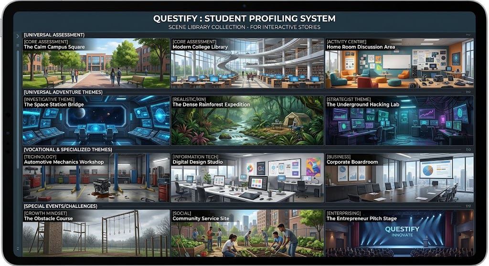
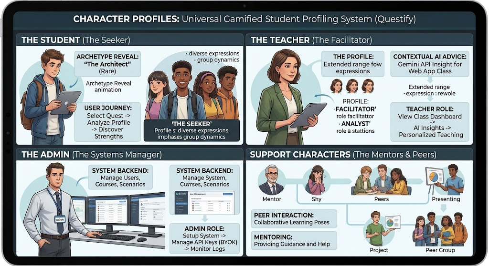
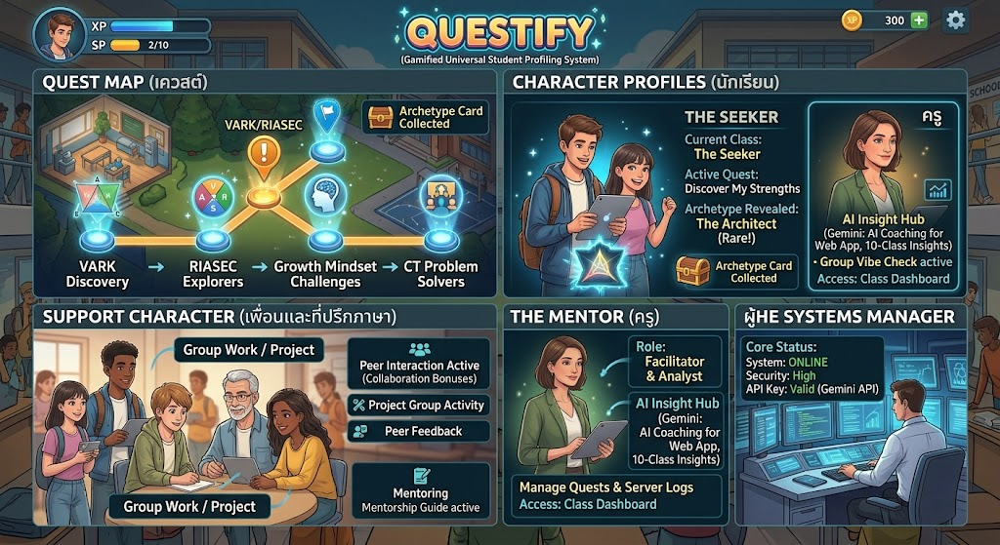
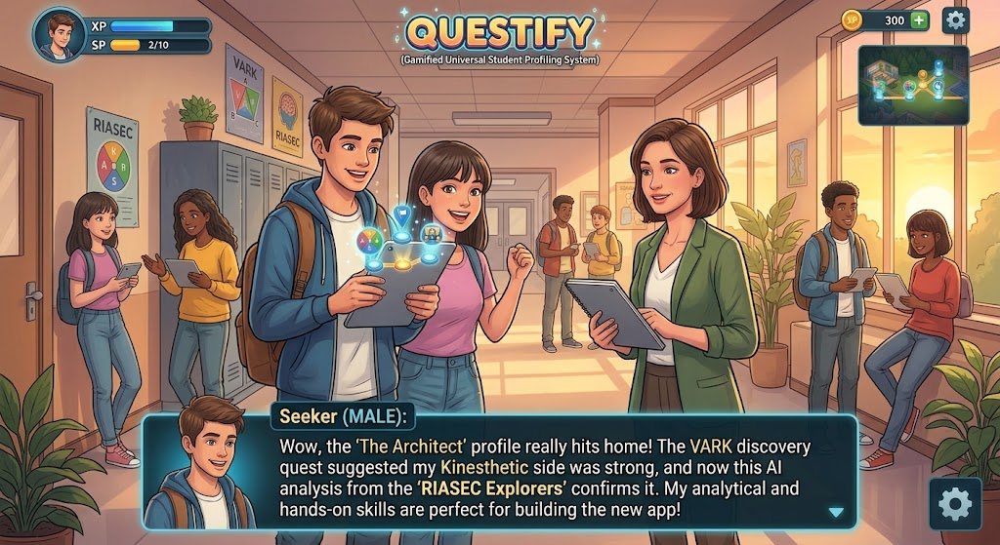

# สรุปการออกแบบจากแชท Gemini (“การออกแบบระบบวัดความรู้และจิตวิทยาผู้เรียน”)

ที่มา: https://share.gemini.google/XwfEIPFjESHc (สร้าง 26 ก.ย. 2569) · ภาพประกอบอยู่ใน [docs/design/](design/)
`requiments.md` คือบทสรุปสุดท้ายของแชทนี้ — เอกสารนี้เก็บ **รายละเอียดที่อยู่ในแชทแต่ไม่ได้อยู่ใน requiments.md**

## 1. แนวคิดที่ตรงกับระบบปัจจุบัน (ทำแล้ว)
- เกมแนว Visual Novel / Interactive Story (Episode, Choices) — แก่นคือ Q&A แต่มีภาพ เสียง แอนิเมชัน
- Stealth Assessment: ผู้เรียนไม่รู้ตัวว่ากำลังทำแบบประเมิน · Rule-based tagging 100% · Zero API cost ตอนเล่น
- VARK / RIASEC / Mindset ผ่านสถานการณ์ · Mindset วัดจากปฏิกิริยาหลังเล่นมินิเกมพลาด (ลองใหม่ vs โทษโชค/ถอดใจ)
- Two-Tier: Core Profile เล่น 1 ครั้ง/ภาคเรียน + Contextual AI ตามรายวิชาบนแดชบอร์ดครู
- Save State, Typewriter, Screen Shake, Fade, BGM + SFX, การ์ด Archetype เชิงบวก + ดาวน์โหลด/แชร์
- เล่นจบ ~10–15 นาที

## 2. รายละเอียดเพิ่มเติมที่อยู่ในแชท (ยังไม่ได้ทำ / ต่างจากที่ทำ)
| หัวข้อ | ในแชท Gemini | สถานะปัจจุบัน |
|---|---|---|
| ชื่อระบบ | **Questify** (Quest + Identify) — ภาพทั้งหมดใช้แบรนด์นี้ · ตัวเลือกอื่น: ArchQuest, Lumina, SkillTree | ใช้ “ARCANA PROFILE” |
| ธีมภาพ | วิทยาลัยสมัยใหม่ ภาพวาดกึ่งสมจริง (digital painting) โทนสว่าง | Dark fantasy ลึกลับ (ผู้ใช้ขอเอง) |
| มิติที่ 4: Computational Thinking | Decomposition, Pattern Recognition, Abstraction, Algorithm · มินิเกมต่อสายไฟ/เรียงบล็อกคำสั่งให้หุ่นยนต์ (Algorithm), หาจุดต่างของรูปแบบ (Pattern) · เป็น add-on สำหรับแผนก IT | ไม่มี (requiments.md ไม่ได้ระบุ) |
| ตัวละคร | **The Seeker** (ผู้เล่น ชาย/หญิง), **The Mentor/Facilitator** (ครู), **The Systems Manager** (แอดมิน), ตัวละครสนับสนุน: Mentor อาวุโส, เด็กขี้อาย, เพื่อนร่วมกลุ่ม, คนนำเสนอ | ตัวละครแฟนตาซี 7 ตัว, ผู้เล่นเป็นมุมมองบุคคลที่ 1 |
| คลังฉาก 12 ฉาก 4 ระดับ | Universal: ลานวิทยาลัย, ห้องสมุด, ห้องโฮมรูม · Adventure: สะพานยานอวกาศ (I), ป่าดิบชื้น (R/K), ห้องแล็บแฮก (Strategist) · Vocational: อู่ซ่อมรถ, สตูดิโอดิจิทัล, ห้องประชุมบริษัท · Special: ด่านอุปสรรค (Mindset), งานจิตอาสา (S), เวทีนำเสนอธุรกิจ (E) | 11 ฉากแฟนตาซี (SVG) |
| Quest Map | เควสต์แยกตามมิติ: VARK Discovery → RIASEC Explorers → Growth Mindset Challenges → CT Problem Solvers | 3 เควสต์ แต่ละเควสต์วัดครบทุกมิติ + Core Profile รวม |
| HUD | XP bar, SP (2/10), เหรียญ, ปุ่มตั้งค่า, มินิแมพ, avatar ผู้เล่นมุมซ้ายบน · กล่องข้อความมีภาพหน้าผู้พูดด้านซ้าย | พลังงาน ✦, กระเป๋าไอเทม, AUTO, เสียง |
| การ์ด | มีระดับความหายาก (Rare, Epic) · ชื่อ archetype ตัวอย่าง: The Architect, The Creator, The Strategist, The Communicator, The Hacker | 6 archetype ตาม RIASEC ไม่มีระดับ |
| กติกาการ์ด | รวม VARK + RIASEC (เช่น V+A สูง และ R+I สูง = The Architect) | ใช้ตัวอักษรแรกของ Holland code |
| ความปลอดภัย | Login ด้วย Google Workspace (ทางเลือก), PDPA: ครูเห็นเฉพาะนักศึกษาที่ตนสอน, ส่งสถิติให้ AI โดยไม่ส่งชื่อ | token login ปกติ (ข้อ PDPA จะทำในเฟส 4) |
| ครู | Game Deployment: กำหนดเควสต์ให้กลุ่มเรียนไหน + ช่วงเวลาเปิด-ปิด · ฟิลเตอร์ (เช่น Fixed Mindset + CT ต่ำ) · % นักศึกษาที่ทำเสร็จ · สุ่มจัดกลุ่มอัจฉริยะ (คละจุดแข็ง) · ปก PDF ว.PA มีข้อมูลวิทยาลัย/แผนก | เฟส 3–6 |
| ข้อมูลผู้ใช้ | prefix/firstname/lastname, semester ใน enrollments | ใช้ full_name เดียว, ภาคเรียนอยู่ใน courses |
| บริบท | ตัวอย่างใช้งานจริง: วิทยาลัยการอาชีพศรีสะเกษ | — |

## 3. ภาพประกอบ
- 
- 
- 
- 
